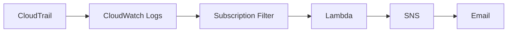
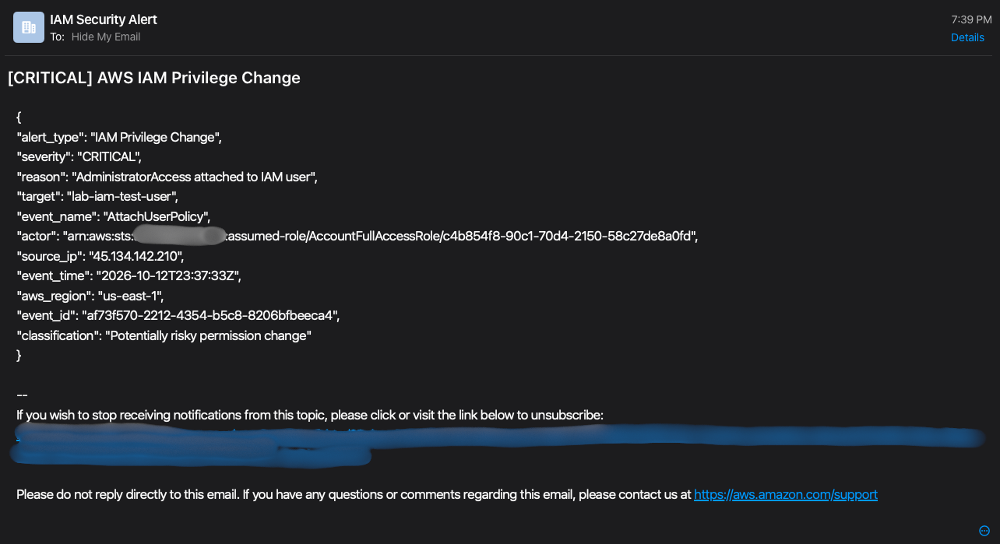

# AWS IAM Privilege Escalation Detection & Incident Response

An AWS-native detection lab that identifies high-risk IAM permission changes, publishes structured findings, and delivers email alerts. A controlled AdministratorAccess attachment on October 12, 2026 validated the complete telemetry-to-notification path. Containment was performed manually and recorded in CloudTrail.

**Verified:** real `AttachUserPolicy` event → CRITICAL finding → SNS email.  
**Scope:** three implemented rules; only the AdministratorAccess attachment was validated end-to-end in AWS.

## Security problem and objectives

IAM permission changes can expand an identity's access without deploying new infrastructure. Analysts need actionable context to distinguish approved administration from unexpected privilege changes.

This lab collects IAM management activity, evaluates selected high-risk changes in Python, and preserves actor, target, source IP, event time, region, and event ID for investigation. It demonstrates detection and manual incident response in an authorized environment; it does not demonstrate an account compromise.

## Architecture



CloudTrail is multi-region. The processing resources are deployed in **us-east-2 (Ohio)**; global IAM events may carry `awsRegion: us-east-1`. Preserve the event's region as evidence rather than substituting the deployment region. EventBridge is not in the working pipeline.

| Service / technology | Lab resource or purpose |
|---|---|
| AWS CloudTrail | `aws-auth-detection-trail`; IAM management telemetry |
| Amazon CloudWatch Logs | `aws-auth-detection-logs`; log storage and investigation |
| Logs subscription filter | `iam-security-event-filter`; delivery to Lambda |
| AWS Lambda / Python | `iam-privilege-escalation-detector`; custom detection engine |
| Amazon SNS | `iam-privilege-escalation-alerts`; email notification |
| AWS IAM | `lab-iam-test-user`; controlled permission-change target |
| Python standard library / boto3 | Payload decoding, JSON processing, SNS publish |

[Architecture and implementation details](docs/architecture.md)

## Detection rules

All rules require `eventSource == iam.amazonaws.com` and no truthy `errorCode`.

| API event | Exact detection condition | Severity | Real AWS validation |
|---|---|---|---|
| `AttachUserPolicy` | AWS-managed `AdministratorAccess` attached to an IAM user | CRITICAL | End-to-end validated |
| `AddUserToGroup` | User added to `lab-privileged-admins` | HIGH | Not end-to-end validated |
| `CreatePolicyVersion` | New default version of `lab-privileged-policy` | HIGH | Not end-to-end validated |

[Rule predicates, triage, and coverage boundaries](docs/detection-rules.md)

## Implementation

The [exported Lambda source](src/lambda_function.py) is preserved unchanged. The handler decodes the subscription event's base64 data, decompresses gzip, and parses each log message as a CloudTrail JSON record. It ignores control messages and evaluates each record with `analyze_event`.

Matching findings are printed as JSON and published to SNS using `SNS_TOPIC_ARN`. Alerts include severity, reason, actor ARN, target, source IP, timestamp, API name, AWS region, and CloudTrail event ID. Original EventBridge-shaped test inputs remain supported for backward compatibility.

## Controlled simulation and response

The lab operator attached `arn:aws:iam::aws:policy/AdministratorAccess` to `lab-iam-test-user`. CloudTrail delivery and the subscription filter invoked Lambda, which classified the change as CRITICAL. SNS delivered an email with subject **`[CRITICAL] AWS IAM Privilege Change`**.

| Step | UTC — October 12, 2026 | EDT — October 12, 2026 | Evidence |
|---|---|---|---|
| AdministratorAccess attached | 23:37:33 | 19:37:33 | Event `af73f570-2212-4354-b5c8-8206bfbeeca4` |
| CRITICAL email received | Exact delivery timestamp not retained; UI shows 19:39 EDT | 19:39 (minute precision) | Screenshot 13 |
| Policy manually detached | Approximately 23:39:15 | Approximately 19:39:15 | Event `713773e9-88a1-4d9e-bb5d-ac06837d003f` |
| Post-test verification | Exact time not recorded | Exact time not recorded | Operator confirmed zero direct policies, no groups, no access keys |

The event-to-containment interval is approximately **1 minute 42 seconds**. This is a single manual-response observation, not a detection-latency measurement or performance benchmark.

[Full incident report](docs/incident-report.md)

## Evidence

### Real detection and containment



*13 — Email from the final real IAM test; the event ID, target, severity, and event time are visible.*


*14 — CloudTrail records manual removal of AdministratorAccess from the test user.*

### Pipeline and supporting IAM activity

| Evidence | What it demonstrates |
|---|---|
| [10 — Real IAM CloudTrail events](screenshots/10-real-iam-cloudtrail-events.png) | Earlier real attachment/detachment activity, with different event IDs from the final test |
| [11 — Lambda detection implementation](screenshots/11-lambda-cloudwatch-detection-code.png) | Subscription decoding and SNS publication in the deployed console code |
| [12 — Subscription filter](screenshots/12-cloudwatch-subscription-filter.png) | Log group subscription streaming to Lambda |

### Configuration and simulated test evidence

| Evidence | Context |
|---|---|
| [01 — CloudTrail configuration](screenshots/01-cloudtrail-configuration.png) | Multi-region trail and logging enabled |
| [02 — CloudWatch log analysis](screenshots/02-cloudwatch-log-analysis.png) | General telemetry query; not a detection-rate measurement |
| [03 — IAM test-user baseline](screenshots/03-iam-test-user-baseline.png) | Empty permissions view before testing |
| [04 — SNS alert configuration](screenshots/04-sns-alert-configuration.png) | Confirmed email subscription |
| [05 — SNS publish policy](screenshots/05-lambda-least-privilege-policy.png) | Topic-scoped publish statement; does not prove the entire execution role is least privilege |
| [06 — Lambda simulated detection test](screenshots/06-lambda-detection-test.png) | Console test using `simulated-event-001` |
| [07 — Simulated SNS alert](screenshots/07-sns-security-alert.png) | Notification from the simulated payload, not the real October 12 event |

Original filenames are retained. Screenshots 08 and 09 are intentionally excluded because they describe the abandoned EventBridge approach.

## MITRE ATT&CK mapping

**[T1098.003 — Account Manipulation: Additional Cloud Roles](https://attack.mitre.org/techniques/T1098/003/)** covers adding cloud roles or permissions. Attaching AdministratorAccess expands an existing IAM user's permissions and is behaviorally aligned with this technique. The parent is [T1098 — Account Manipulation](https://attack.mitre.org/techniques/T1098/).

The mapping describes the simulated action. It does not establish malicious persistence, initial access, compromised credentials, or unauthorized activity.

## Verification

Run the offline simulated tests from the repository root:

```sh
python3 -m unittest discover -s tests -v
```

The suite uses synthetic CloudTrail records, compressed subscription payloads, and a mocked boto3 SNS client. It needs no AWS credentials or third-party installation. These unit tests validate code behavior locally; they do not extend the two HIGH rules' real AWS validation status. See [test scope](tests/README.md).

## Security considerations and limitations

- Exact policy/group matches cover a narrow set of changes, not every privilege-escalation path. Policy contents and effective permissions are not evaluated.
- The source has no event-ID deduplication, per-record error isolation, or caught SNS publication failures. Malformed input or an SNS exception can interrupt a batch; repeated delivery may produce repeated alerts.
- Notification delivery depends on the logging pipeline, Lambda permissions, SNS configuration, and confirmed email subscription. No delivery SLA or sustained-load test was established.
- The lab detects and alerts. It does not perform automated containment.
- All evidence was inspected for readable account identifiers, credentials, personal endpoints, and unsubscribe URLs. Screenshot 01 uses the owner-supplied redacted replacement. See the [security review](docs/security-review.md) before approving public release.

## Engineering lessons

An initial EventBridge design encountered regional delivery constraints for global IAM events in Ohio, compounded by the AWS Free plan's region restriction in this lab. The pipeline was redesigned around CloudTrail delivery to CloudWatch Logs and a Lambda subscription. Real IAM activity validated the revised path.

The central lessons were to verify telemetry delivery separately from rule logic, preserve the difference between event region and processing region, and distinguish synthetic tests from end-to-end evidence. [Engineering decision and lessons](docs/lessons-learned.md)

## Future improvements

Validate the two HIGH rules in AWS; add effective-permission context and approval correlation; implement event-ID deduplication and per-record error handling; monitor pipeline health and publish failures; and codify reviewed infrastructure and least-privilege permissions. These are proposed improvements, not deployed capabilities.
