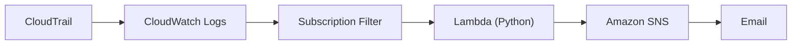
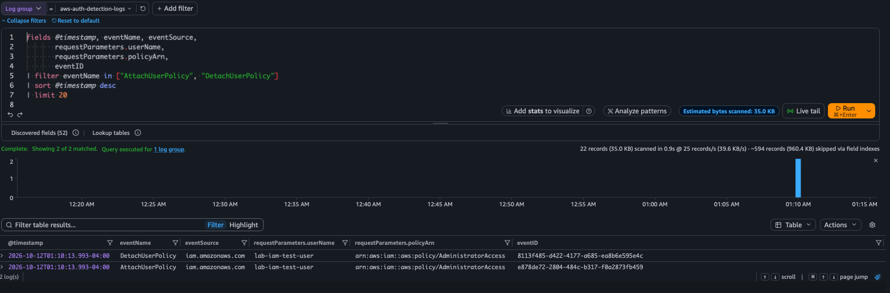
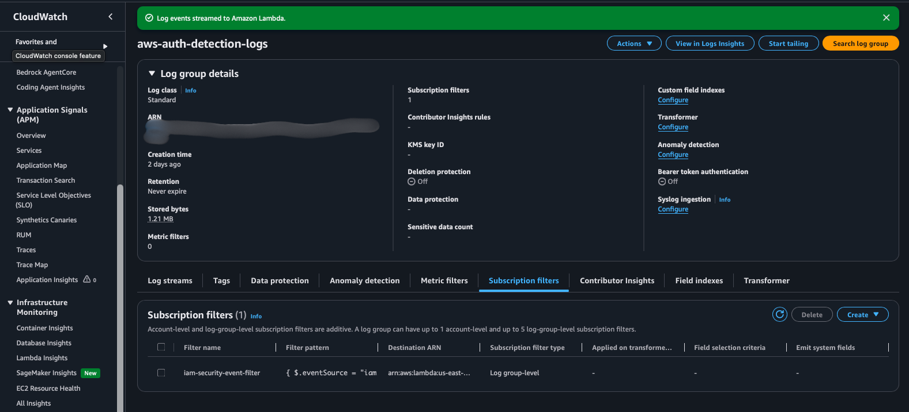
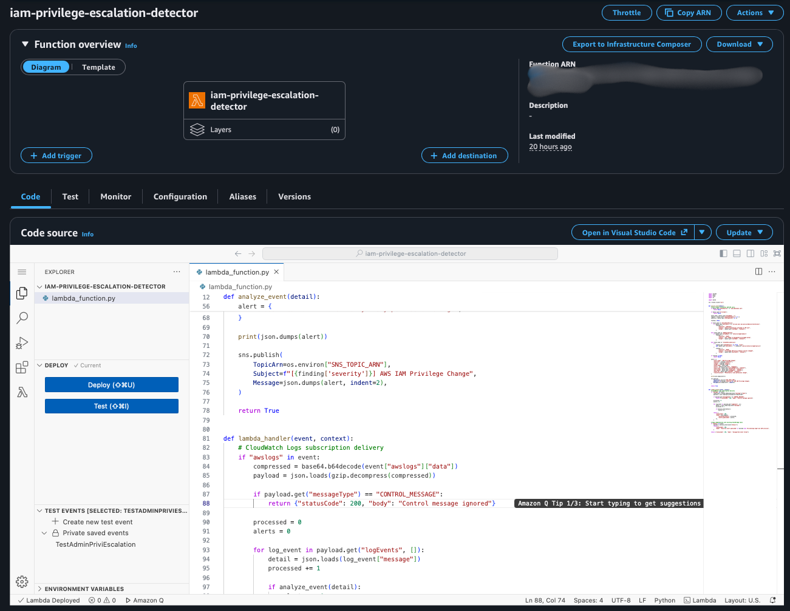
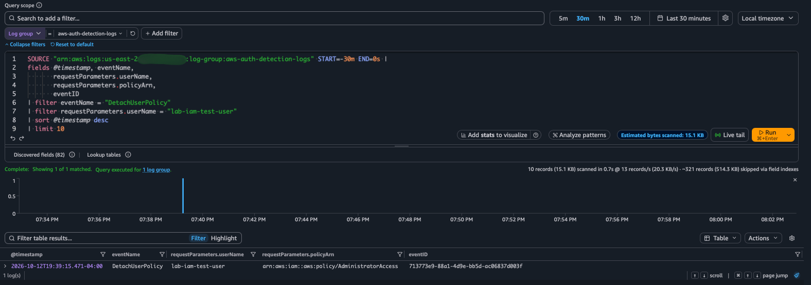

# AWS IAM Privilege Escalation Detection & Incident Response

An AWS-native security lab that detects selected high-risk IAM permission changes and delivers structured email alerts. An authorized AdministratorAccess attachment on October 12, 2026 validated the complete CloudTrail-to-SNS path, followed by investigation and manual containment. Three rules are implemented; only the AdministratorAccess attachment rule has real AWS end-to-end validation.

## Key project outcomes

**Real AWS validation — authorized lab**

- Detected a real IAM `AttachUserPolicy` event and classified the AdministratorAccess attachment as **CRITICAL**.
- Automatically delivered a structured Amazon SNS email alert with identity and event context.
- Investigated the permission change using CloudTrail evidence.
- Manually removed the elevated permission and correlated the removal event.
- Verified the test user's post-remediation state: zero directly attached policies, no group memberships, and no access keys. These checks were confirmed by the operator; the removal screenshot proves the detach event.

**Local code validation — simulated inputs**

- Passed **22 offline unit tests** covering rule matches, exclusions, subscription payload handling, SNS publication, and documented failure behavior. These tests do not extend the other two rules' AWS validation status.

## Architecture



The multi-region CloudTrail trail feeds processing resources in **us-east-2 (Ohio)**. Global IAM events may report `awsRegion: us-east-1`; the finding preserves that original event region.

## Technologies used

| Technology | Resource / role |
|---|---|
| AWS CloudTrail | `aws-auth-detection-trail` — management telemetry |
| Amazon CloudWatch Logs | `aws-auth-detection-logs` — collection and investigation |
| Logs subscription filter | `iam-security-event-filter` — delivery to Lambda |
| AWS Lambda / Python | `iam-privilege-escalation-detector` — detection engine |
| Amazon SNS | `iam-privilege-escalation-alerts` — email notification |
| AWS IAM | `lab-iam-test-user` — controlled test target |
| Python / boto3 | Base64, gzip, JSON, and SNS publication |

## Detection rules

Each rule requires `eventSource == iam.amazonaws.com` and no truthy `errorCode`.

| API event | Detection condition | Severity | AWS validation |
|---|---|---|---|
| `AttachUserPolicy` | AWS-managed `AdministratorAccess` attached to a user | CRITICAL | End-to-end validated |
| `AddUserToGroup` | User added to `lab-privileged-admins` | HIGH | Not validated end-to-end |
| `CreatePolicyVersion` | New default version of `lab-privileged-policy` | HIGH | Not validated end-to-end |

Exact predicates, matching boundaries, and triage guidance are in [detection rules](docs/detection-rules.md).

## Implementation overview

The unchanged [Lambda export](src/lambda_function.py) decodes base64 subscription data, decompresses gzip, and parses each log message as a CloudTrail JSON record. It ignores control messages and failed IAM API calls, then evaluates the three rules.

Matching findings are printed as JSON and published to the topic configured through `SNS_TOPIC_ARN`. Each alert includes severity, reason, actor ARN, target, source IP, event time, API name, AWS region, and event ID.

EventBridge was an earlier architectural experiment. Regional IAM event-delivery constraints and the lab's AWS Free plan region restriction led to the working CloudWatch Logs subscription design. The export retains EventBridge-shaped test-input compatibility. [Architecture details](docs/architecture.md) and [engineering lessons](docs/lessons-learned.md) explain the decision.

## Real AWS test and investigation

The operator attached `arn:aws:iam::aws:policy/AdministratorAccess` to `lab-iam-test-user`. CloudTrail delivery and the subscription filter invoked Lambda; the detector generated a CRITICAL finding, and SNS delivered an email with subject **`[CRITICAL] AWS IAM Privilege Change`**.

Investigation correlated the target, initiating identity, policy, source IP, event region, and event ID. The operator then detached the policy manually and verified the test user's access state. This was an authorized simulation; no actual account compromise occurred, and no automated remediation is claimed.

## Incident response timeline

All entries are on **October 12, 2026**. EDT is UTC−04:00.

| Activity | UTC | EDT |
|---|---|---|
| AdministratorAccess attached | 23:37:33 | 19:37:33 |
| CRITICAL SNS email observed | Approx. 23:39 | Approx. 19:39; UI has minute precision |
| Policy manually removed | Approx. 23:39:15 | Approx. 19:39:15 |
| Post-test access verification | Time not recorded | Time not recorded |

CloudTrail event IDs:

- **Attachment:** `af73f570-2212-4354-b5c8-8206bfbeeca4`
- **Removal:** `713773e9-88a1-4d9e-bb5d-ac06837d003f`

The approximately **1-minute-42-second** interval measures event-to-manual-containment time in this exercise. It is not measured detection latency, an SLA, or a performance benchmark. See the [incident report](docs/incident-report.md) for evidence provenance and timestamp limits.

## Evidence screenshots

### Primary evidence: real CRITICAL alert


*11 — Delivered SNS email showing the CRITICAL classification, target, initiating identity, event time, region, and final test's CloudTrail event ID.*

### Telemetry: real IAM CloudTrail activity



*08 — Earlier real attachment and detachment events confirm IAM telemetry in CloudWatch Logs. Their event IDs differ from the final test; this image does not prove the final alert's event correlation.*

### Log delivery: CloudWatch subscription filter



*10 — The named log subscription and console confirmation of streaming to Lambda establish the working delivery mechanism. The full filter pattern and destination ARN are truncated.*

### Detection implementation: deployed Lambda



*09 — Console code shows base64/gzip subscription decoding, CloudTrail record processing, and SNS publication. The unchanged export is available in the source directory.*

### Manual containment: IAM privilege removal



*12 — The final test's `DetachUserPolicy` event records removal of AdministratorAccess from the same user. This proves the manual removal event; final-state inventory checks were confirmed separately by the operator.*

<details>
<summary>Supporting evidence — configuration, baseline, and simulated tests</summary>

| Screenshot | Evidence scope |
|---|---|
| [01 — CloudTrail configuration](screenshots/01-cloudtrail-configuration.png) | Logging enabled on a multi-region trail; owner-supplied redacted image. |
| [02 — CloudWatch analysis](screenshots/02-cloudwatch-log-analysis.png) | General telemetry query; not a detection-rate measurement. |
| [03 — Test-user baseline](screenshots/03-iam-test-user-baseline.png) | Empty permissions view before testing; not post-remediation proof. |
| [04 — SNS configuration](screenshots/04-sns-alert-configuration.png) | Confirmed email subscription. |
| [05 — SNS publish policy](screenshots/05-lambda-least-privilege-policy.png) | Topic-scoped publish statement; not proof of the entire role's least privilege. |
| [06 — Simulated Lambda test](screenshots/06-lambda-detection-test.png) | Successful console invocation with `simulated-event-001`. |
| [07 — Simulated SNS alert](screenshots/07-sns-security-alert.png) | Delivered alert from that synthetic payload; not the real October 12 event. |

</details>

All 12 screenshots are numbered sequentially from 01 to 12. Images documenting the abandoned EventBridge approach are not included.

## MITRE ATT&CK mapping

Attaching AdministratorAccess expands an existing IAM user's permissions, aligning with **[T1098.003 — Account Manipulation: Additional Cloud Roles](https://attack.mitre.org/techniques/T1098/003/)**, under [T1098 — Account Manipulation](https://attack.mitre.org/techniques/T1098/).

The mapping describes the observed permission modification. It does not establish unauthorized access or malicious persistence.

## Limitations and future improvements

- **Narrow coverage:** exact policy/group matches do not evaluate policy contents or effective permissions, and omit other escalation paths.
- **Operational limits:** no event-ID deduplication, per-record error isolation, or caught SNS errors. Malformed input or publication failure can interrupt a batch; repeated delivery can repeat alerts.
- **Validation limits:** one rule was tested end-to-end in AWS. No sustained-load test or delivery SLA was established. Containment remains manual.

Proposed improvements include real AWS validation of both HIGH rules, approval correlation, effective-permission context, deduplication, failure handling, pipeline health monitoring, and reviewed infrastructure as code. These are future work, not deployed capabilities.

## Supporting documentation and tests

| Reference | Details |
|---|---|
| [Architecture](docs/architecture.md) | Security objectives, payload processing, permissions evidence, and configuration boundaries |
| [Detection rules](docs/detection-rules.md) | Exact source predicates, finding schema, and triage |
| [Incident report](docs/incident-report.md) | UTC/EDT timeline, investigation, response, and final-state evidence limits |
| [Lessons learned](docs/lessons-learned.md) | Telemetry troubleshooting and engineering decisions |
| [Security review](docs/security-review.md) | Screenshot privacy review and source inspection |
| [Offline test scope](tests/README.md) | Synthetic fixtures, mocked SNS calls, and current code behavior |

Run from the repository root:

```sh
python3 -m unittest discover -s tests -v
```

The tests need no live AWS credentials or third-party installation. They validate simulated code behavior separately from the completed real AWS test.
