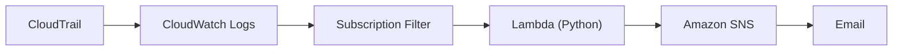

# Architecture and implementation

## Security problem and objectives

IAM permission changes can expand an identity's access without deploying new infrastructure. Analysts need actionable context to distinguish approved administration from unexpected privilege changes.

This lab collects IAM management activity, evaluates selected high-risk changes in Python, and preserves actor, target, source IP, event time, region, and event ID for investigation. It demonstrates detection and manual incident response in an authorized environment; it does not demonstrate an account compromise.

## Working data flow

`aws-auth-detection-trail` is a multi-region trail delivering into `aws-auth-detection-logs`. The log group's `iam-security-event-filter` subscription invokes `iam-privilege-escalation-detector`. Matching findings are published to `iam-privilege-escalation-alerts` and delivered to a confirmed email subscriber. Processing resources are in `us-east-2`.

The final real alert carries `awsRegion: us-east-1` for global IAM activity. This event field is retained unchanged. The deployment region and event region describe different things.

## Exported source behavior

[src/lambda_function.py](../src/lambda_function.py) is a byte-for-byte copy of the supplied export. It imports boto3 and creates an SNS client at module load. `SNS_TOPIC_ARN` is read from the environment when publishing. No account-specific topic ARN or credential is hardcoded.

For inputs containing `awslogs`, `lambda_handler`:

1. Base64-decodes `awslogs.data` and decompresses gzip.
2. Parses the resulting JSON payload.
3. Returns success without processing `CONTROL_MESSAGE` payloads.
4. Parses each `logEvents[].message` as an individual CloudTrail record.
5. Calls `analyze_event` and counts processed records and published alerts.
6. Returns those counts in a JSON-encoded response body.

`analyze_event` rejects non-IAM records and records with a truthy `errorCode`. A matching rule constructs and prints a structured alert, publishes it to SNS, then returns `True`; unmatched records return `False`. Missing identity or context fields generally become `unknown` in findings.

Inputs containing `detail` use the backward-compatible EventBridge-shaped test path. This does not establish an EventBridge deployment. Unsupported envelopes return status code 400.

## Permissions and configuration evidence

[Screenshot 12](../screenshots/12-cloudwatch-subscription-filter.png) shows one subscription filter and the console confirmation that events are streamed to Lambda. The filter pattern and destination ARN are truncated in the screenshot; their complete values cannot be independently reconstructed from this evidence.

[Screenshot 05](../screenshots/05-lambda-least-privilege-policy.png) shows an `sns:Publish` statement scoped to the alerts topic, in the `PowerUserRole` policy editor. It supports the existence of a scoped publish statement, but does not establish the complete attached policy set or a fully least-privilege execution role. No IAM policy or infrastructure export was supplied.

The CloudTrail configuration shows log-file validation enabled, organization scope not enabled, and SSE-KMS for log files not enabled. The log-group screenshot shows retention set to never expire. These are observed lab settings, not production configuration recommendations.

## Operational boundaries

The function does not catch decoding, JSON, environment-variable, or SNS errors. There is no per-record recovery, deduplication, or enrichment of IAM effective permissions. A failed publish raises an exception; its alert may already have been printed. Thus a printed finding alone is not proof of SNS delivery.

No automated remediation, infrastructure-as-code deployment, pipeline health alarm, or retry/dead-letter configuration is claimed. The repo documents the completed lab rather than supplying a production deployment package.

[Back to README](../README.md)
